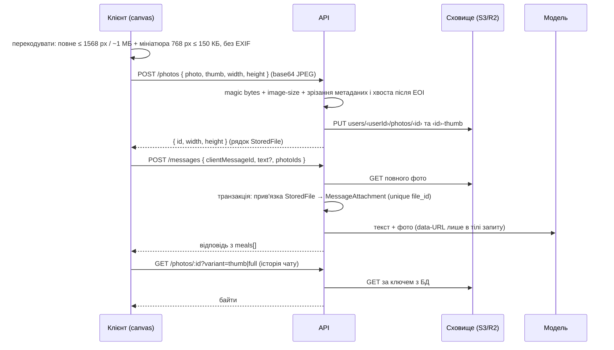

# Архітектурні рішення «Кусь»

Рішення, які не видно з коду одного модуля, але які обмежують кілька частин одразу. Схема БД — [`database.md`](database.md).

## Web ↔ API: один origin через rewrite

**Рішення:** web (Vercel) звертається до API лише за відносним шляхом `/api/*`. `apps/web/vercel.json` проксіює його на Railway і додає секретний заголовок (див. нижче). Локально те саме робить `server.proxy` у Vite (`apps/web/vite.config.ts`: `/api` → `http://localhost:3000`); базова адреса клієнта — стала `/api/v1` (`shared/config/api.ts`), без `VITE_API_URL` і без `withCredentials`.

**Чому:** auth-cookie мають `SameSite=Lax`. `*.vercel.app` і `*.up.railway.app` — різні сайти, тож без rewrite браузер не відправляє такі cookie у `fetch` між ними. З `SameSite=None` їх однаково блокує Safari (ITP), а на iPhone — головна платформа. З rewrite браузер бачить один origin: cookie first-party, CORS для браузера не потрібен, а `Lax` разом з JSON-only API закриває CSRF.

**Наслідки:**

- `COOKIE_DOMAIN` не задаємо: cookie host-only, прив'язані до домену web. Змінна лишається опційною на випадок власного домену з піддоменами (`app.` + `api.`).
- `CORS_ORIGIN` лишається для локальної розробки й прямих запитів; `*` заборонено схемою env.

### API лише через Vercel і IP клієнта для throttler

Ланцюжок у проді: клієнт → Vercel → edge Railway → API. `req.ip` там — вихідний IP Vercel, спільний для всіх, а `X-Real-IP` Railway перезаписує тим самим IP Vercel. Довіряти `X-Forwarded-For` не можна: домен Railway відкритий напряму, і заголовок підробляється.

- **Секрет проксі.** `vercel.json` (`routes[].transforms`, `request.headers` / `set`) додає до кожного `/api` запиту `x-kus-proxy-secret` зі змінної Vercel `API_PROXY_SECRET` — у git секрету немає. API з `API_PROXY_SECRET` (обов'язкова в production, ≥ 32 символи) відповідає `404 NOT_FOUND` на все без правильного заголовка (порівняння SHA-256 у постійному часі, `common/proxy`), крім `GET /api/v1/health` для healthcheck Railway. Саме тому не `vercel.ts` з `deploymentEnv`: у документації vercel.com заголовки з env задокументовані лише для `transforms`.
- **IP для throttler** — `x-vercel-forwarded-for` (Vercel перезаписує його й не пропускає чужі значення; якщо раптом прийде список — останнє значення), і лише для запитів, які пройшли шлюз із правильним секретом. Відкритий `/health`, локальні запуски й тести беруть `req.ip`, тож підроблений заголовок не дає нового кошика. Без заголовка за проксі — один `warn` у лозі (усі ділять один кошик). `helmet()` стоїть перед шлюзом, тож його 404 мають ті самі заголовки. `trust proxy` вимкнено.
- **Перевірено на проді (2026-10-08):** реєстрація й запис їжі через Vercel проходять — секрет доходить до API. Що до зовнішнього origin доходить і `x-vercel-forwarded-for` (документація прямо цього не каже), підтверджує відсутність `warn` «is missing behind the proxy» у логах API і окремі ліміти входу з Wi-Fi і з мобільного інтернету. Якщо заголовка немає — Routing Middleware з `ipAddress()` і власним заголовком.

### Деплой

Прод: web — https://kus-psi.vercel.app, API — https://kusapi-production.up.railway.app (напряму відповідає лише `/api/v1/health`). Точні налаштування Railway і Vercel, змінні, деплой з міграцією, бекапи й відновлення — [`deploy.md`](deploy.md).

- **Railway** (налаштування в UI сервісу, не в репо: config as code deprecated): збірка з кореня монорепо (`--prod=false`, бо з `NODE_ENV=production` pnpm пропустив би devDependencies), `prisma migrate deploy` як pre-deploy, healthcheck `/api/v1/health` — він робить `SELECT 1`, тож деплой з недоступною БД не стає живим (`503 SERVICE_UNAVAILABLE`). Регіон EU West.
- **Vercel** (`apps/web/vercel.json`): CSP (`default-src 'self'`, `style-src 'unsafe-inline'` для inline-стилів Motion, шрифти власні), `/assets/*` — `immutable`, оболонка й service worker — `no-cache`, SPA-fallback після файлової системи.
- **Що CSP і `Permissions-Policy` ще закривають:** `microphone=()` зламає справжній голосовий ввід, а `connect-src 'self'` — Sentry (`*.ingest.sentry.io`); з появою кожного — розширити. Фото через `<input type="file">` (без `capture`: iOS сам пропонує «Камера / Галерея») під `camera=()` не підпадає. Відсутній файл у `/assets` — 404 з `no-store`, не SPA-оболонка.
- **Preview-деплої Vercel** ходять у той самий продакшн API (`dest` фіксований): гілка з поламаним фронтом працює з живими даними.
- **Застаріла версія PWA:** після деплою старі чанки зникають; `vite:preloadError` → одне автоматичне перезавантаження (10 с захисту від циклу), далі — `RouteErrorPage` з кнопкою.
- **Таймаут:** проксі Vercel обриває зовнішній запит через 120 с. Розбір AI обмежено 95 с (`AI_PARSE_DEADLINE_MS`, 45 с на спробу), плюс до 20 с на БД — хід вкладається (див. «Повтори»). SSE чи асинхронна черга — коли знадобляться довші відповіді.

## Auth

Модулі `apps/api/src/modules/auth` і `users`. Контракти запитів і відповідей — `packages/shared/src/schemas/auth.ts`.

|        | Access                                                                        | Refresh                                       |
| ------ | ----------------------------------------------------------------------------- | --------------------------------------------- |
| Формат | JWT HS256 `{ sub, fam }` (`fam` = `Session.tokenFamily`), `JWT_ACCESS_SECRET` | Випадкові 32 байти, base64url; у БД — SHA-256 |
| TTL    | 15 хв                                                                         | 30 днів                                       |
| Cookie | `kus_access`, path `/api/v1`                                                  | `kus_refresh`, path `/api/v1/auth`            |

Обидві cookie — `HttpOnly`, `SameSite=Lax`, `Secure` у production. Токени ніколи не потрапляють у JS (`localStorage` тощо).

**Потік:**

- `POST /auth/register` — лише коли `ALLOW_REGISTRATION=true` (guard → 403 ще до валідації тіла). Одразу логінить.
- `POST /auth/login` — нова `tokenFamily` = нова сесія пристрою. Невідомий email і невірний пароль дають однаковий `INVALID_CREDENTIALS`; для невідомого email виконується argon2-verify з dummy-хешем, щоб час відповіді не видавав, що акаунта немає. 5 невдалих спроб → `lockedUntil` на 15 хв (`ACCOUNT_LOCKED`, 423 — компроміс описаний у [`database.md`](database.md#відкладено)). Спроба «резервується» одним умовним `UPDATE` **до** перевірки пароля (лише якщо акаунт не заблоковано й лічильник < 5), тож паралельні запити не дають більше 5 перевірок пароля за вікно; успішний вхід скидає лічильник.
- `POST /auth/refresh` — ротація: старий рядок `Session` отримує `usedAt` (умовний `updateMany`, тож із двох паралельних запитів виграє один), новий створюється в тій самій сім'ї. Пред'явлено вже використаний токен поза grace-вікном (нижче) → відкликається вся сім'я (`REFRESH_TOKEN_REUSED`).
- `POST /auth/logout` — публічний (працює і з простроченим access): відкликає сім'ю поточного refresh. `POST /auth/logout-all` — усі сесії користувача.
- `POST /auth/change-password` — поточний пароль перевіряється тим самим кодом, що й логін (резервування спроби, lockout після 5 невдач), новий хешується argon2, і в одній транзакції відкликаються всі сім'ї користувача, крім `fam` з access-токена: інші пристрої виходять, цей лишається. Невірний поточний пароль — `400 PASSWORD_INCORRECT`, не 401: фронт на 401 поза `/auth/*` робить refresh і завершує сесію. Throttle як на логіні.
- **Видалення акаунта** (`modules/account`): `POST /account/delete { password }` — той самий `PASSWORD_INCORRECT` / lockout, далі `deletionRequestedAt = now`, `purgeAt = +30 днів`, усі сесії відкликано, cookie очищено (204). Логін у такий акаунт успішний, а `AuthUser` несе `pendingDeletion` і `purgeAt` для екрана account-restore. Глобальний `PendingDeletionGuard` (третій `APP_GUARD`, після `JwtAuthGuard`, один PK-запит на виклик) відповідає `403 ACCOUNT_PENDING_DELETION` на все, крім `@Public()` (logout, refresh) і `@AllowPendingDeletion()` (`POST /account/restore`, `GET /users/me`). `AccountPurgeService` щодня о 04:00 жорстко видаляє рядки з `purgeAt < now` (каскад по всіх таблицях) разом з файлами фото у сховищі (деталі — у розділі про фото), лог лише з кількістю. `restore` дозволений лише поки `purgeAt > now`, інакше `409 ACCOUNT_RESTORE_EXPIRED`: видалення файлів незворотне, тож між `purgeAt` і запуском job акаунт уже не повертається. Email лишається зайнятим до purge. Успішний restore (акаунт справді чекав на видалення) у тій самій транзакції пише в чат повідомлення від Kusik «З поверненням, Богдане! …» (`ChatGreetingsService`, шаблон із `common/i18n`, звертання за тим самим правилом, що й привітання чату: `addressAs`, інакше безпечний кличний відмінок імені з `@kus/shared`; без виклику моделі). Повторний restore нічого не додає. У стрічці це єдине повідомлення ASSISTANT без `replyToId`, і фронт показує його з радісним обличчям хом'яка.
- `JwtAuthGuard` глобальний; відкриті роути — `@Public()`. Окрім підпису, guard перевіряє, що в сім'ї з токена є поточна сесія. Ціна — два індексовані запити на виклик; виграш — logout, logout-all і reuse відрізають access-токени одразу, а не через 15 хв.
- **Інваріант:** відкликання завжди стосується всієї сім'ї, тож сім'я мертва, щойно в ній є хоч один рядок з `revokedAt`. Guard і refresh перевіряють саме це — тому рядок, який паралельна ротація закомітила одразу після відкликання, теж мертвий. Старий токен уже відкликаної сім'ї (стара вкладка після logout) — `REFRESH_TOKEN_INVALID`, без тривоги про reuse.

**Що має знати фронт:**

- Будь-який 401 на звичайному роуті → один `POST /auth/refresh` → повторити запит. Refresh-запити все одно робити **single-flight** (один на застосунок): grace-вікно — страховка, а не звичайний шлях.
- 401 від самого `/auth/refresh` → на екран входу.

**Як це зроблено у web:**

- `shared/api/attach-refresh-interceptor.ts` — single-flight refresh: паралельні 401 чекають один `POST /auth/refresh`, потім кожен запит повторюється один раз (`isAuthRetry`). 401 від `/auth/login|register|refresh|logout` refresh не запускає. Refresh упав з мережею чи 5xx — сесія не скидається.
- Сесія — запит `['session', 'me']` (`entities/session`): `GET /users/me`, 401 після refresh = `null` («анонім» як стан, не помилка).
- Мертвий refresh → `endSession`: прибрати всі інші запити з кешу й записати сесію як `null`. Не `queryClient.clear()`: інакше guard знову спитає `/users/me` і почнеться коло refresh. Перехід на /login робить лише guard захищених маршрутів; на /login і /register — нічого.
- `SessionGuard` (`app/router`): поки сесія невідома — лише `Loader`; `/app/*` без сесії → /login зі `state.from`; з сесією /login і /register → `from` (лише шлях усередині `/app`) або `/app`. Мережева помилка перевірки на `/app` — екран «Повторити», не вихід.

**Grace-вікно для refresh — 20 с** (`REFRESH_REUSE_GRACE_MS`, `SessionService.reissueWithinGrace`). Закриває два випадки, яких не закриває single-flight: (1) refresh дійшов і закомітився, а відповідь загубилась у мобільній мережі, і клієнт повторює зі старим токеном; (2) PWA і вкладка Safari на iPhone ділять cookie, але не single-flight. Повтор використаного токена — **не** reuse, якщо одночасно:

- від його використання минуло ≤ 20 с;
- його наступник ще не використаний (у сім'ї немає рядка з пізнішим `usedAt`);
- у сім'ї рівно одна поточна сесія — тобто grace спрацьовує один раз на ротацію.

Тоді видається **нова пара в тій самій сім'ї** (повернути наступника не можна — у БД лише хеші), без відкликання й без `warn` у лозі (лише `log`). Перевірка й видача йдуть у транзакції під `pg_advisory_xact_lock` на сім'ю, тож два одночасні повтори не видадуть дві пари. Поза вікном або після використання наступника — як раніше: відкликання всієї сім'ї, `REFRESH_TOKEN_REUSED`. Два паралельні refresh одним токеном тепер обидва отримують 204: переможець ротує, другий проходить через grace.

**Ціна:** токен, викрадений і пред'явлений у ці 20 с, дає атакеру власну пару в сім'ї без тривоги, і її можна тихо ротувати далі — reuse спрацює, лише якщо хтось пред'явить уже використаний токен поза вікном. Logout і logout-all відкликають і цю пару (вони діють на всю сім'ю). Для одного користувача на телефоні це прийнятний обмін на «не розлогінює в метро».

**Rate limiting** (`@nestjs/throttler`, in-memory, бо інстанс API один): за замовчуванням 100 запитів/хв на IP; `/auth/login` і `/auth/register` — 5/хв; `/auth/refresh` — 30/хв. Ліміт «на акаунт» — це lockout.

## Профіль і цілі

Модуль `apps/api/src/modules/profile`; контракти — `packages/shared/src/schemas/profile.ts`, розрахунок — чиста функція `calculateGoals` у `packages/shared/src/goals/calculate-goals.ts` (Міффлін–Сан Жеор × коефіцієнт активності ± темп × 7700 / 7, ккал округлюються вниз до 50, межі 1500 / 1200 ккал і 1 % ваги на тиждень, білок 1,8 г на кг бажаної ваги, жир 0,95 г на кг, вуглеводи — решта; `warnings` кажуть, яка межа спрацювала).

- `GET /profile` — акаунт, «Мої дані» (вік замість року народження), остання вага, ціль на сьогодні з `source`. `PATCH /profile` — часткове оновлення в транзакції; `weightKg` стає зважуванням на локальний день. Межі: вік 18–100 (Kusik лише для дорослих: формула для дорослих і згода на обробку даних; молодший вік → `422` з кодом `AGE_BELOW_MINIMUM` у полі), зріст 120–230, вага 30–300.
- `POST /auth/change-password` відмовляє новому паролю, що збігається з поточним: `400 PASSWORD_SAME` (перевірка після підтвердження поточного, щоб помилка нічого не видавала).
- `POST /profile/goals/preview` — розрахунок без збереження (goals-recalc, «розраховано N» у goals-edit-sheet) плюс `current`; неповний профіль → `409 PROFILE_INCOMPLETE` з полями. `PUT /profile/goals` — `calculated` (сервер рахує сам, клієнтським числам не вірить) або `manual` (`400 GOALS_INCONSISTENT`, якщо Б/В/Ж не сходяться з ккал у межах 15 %). Обидва пишуть `UserGoal` з `validFrom = сьогодні`, минулі дні лишаються з попередньою ціллю.

## AI-ядро: повідомлення в чаті

`POST /api/v1/messages { clientMessageId, text }` → модуль `chat` → `ai` (OpenRouter) → `entries` / `memory`. Один виклик моделі на повідомлення; SSE — на етапі 4 разом з UI чату.

**Потік.** Повідомлення користувача пишеться як `PENDING` → резерв денного ліміту (`DailyUsage`, `AI_DAILY_MESSAGE_LIMIT`, за локальним днем) → контекст → модель → одна транзакція: відповідь асистента, Meal/FoodEntry, Clarification, `COMPLETED`. Виклик моделі — **поза** транзакцією. Будь-яка помилка → повідомлення `FAILED`, клієнт показує «Не надіслано» й повторює з тим самим `clientMessageId`.

**Ідемпотентність** (`unique(userId, clientMessageId)`): повтор `COMPLETED` повертає збережену відповідь без моделі; `FAILED` (або `PENDING`, старший за 2 хв — загублений після падіння) береться на повторну обробку умовним `updateMany`, тож два паралельні повтори не підуть до моделі обидва; поки перший запит іде — `409 MESSAGE_IN_PROGRESS`; той самий id з іншим текстом або іншими фото — `409 CLIENT_MESSAGE_ID_REUSED`.

**Модель.** Запит, промпт, інструменти (`log_food`, `clarify`, `not_food`, `photo_unusable`, `reply`), схема відповіді й валідація — в `packages/shared/src/ai` (одне джерело для бекенду й `packages/ai-eval`). `AI_MODEL` (за замовчуванням), `AI_MODEL_VISION` / `AI_MODEL_CHAT` (порожні → `AI_MODEL`). `temperature: 0`. `provider.data_collection: "deny"` — лише провайдери, що не зберігають і не навчаються на даних. `tool_choice: "auto"`, бо «приватні» ендпоінти Claude Sonnet 5.5 не приймають `required`, а `require_parameters` відсіює моделі без `temperature`; відповідь текстом без інструмента — це помилка валідації з повтором. Статичний промпт позначено `cache_control` (у Claude кеш знижує вартість запиту ~у 3 рази). Вихід — до 8 000 токенів: опис цілого дня на 10+ позицій разом з роздумами моделі не вміщався у 2 000 і обрізався. Роздуми — `reasoning: { effort: "low" }`: вимкнути їх на Sonnet 5.5 не можна (400 «Reasoning is mandatory»), а проти `minimal` `low` дав ту саму похибку, більше правильних рішень і вдвічі швидші довгі повідомлення (`PROMPT_CHANGELOG.md`).

**Повтори.** SDK `openai`: таймаут `AI_TIMEOUT_MS` на спробу і 1 повтор на мережеву помилку / 429 / 5xx. Відповідь, що не пройшла zod або перевірки бекенду, — 1 повтор з текстом помилок у повідомленнях `tool`. Далі — `503 AI_UNAVAILABLE`. Обрізана відповідь (`finish_reason: "length"`, аргументи частково або `{}`) не повторюється — той самий запит обріжеться так само: `AiRun` з `errorCode: OUTPUT_TRUNCATED`, WARN у лозі, клієнту одразу `422 MESSAGE_TOO_LONG` («розбий повідомлення»), а не 503 — повторне надсилання того самого тексту обрізалось би знову. Арифметика лімітів: 8 000 токенів при ~180–200 ток/с ≈ 45 с, тому таймаут спроби `AI_TIMEOUT_MS` — 45 с, а загальний дедлайн розбору з усіма повторами `AI_PARSE_DEADLINE_MS` — 95 с: разом з роботою БД (бюджет 20 с) хід закінчується раніше, ніж проксі Vercel обриває зовнішній запит (120 с), тож телефон отримує справжню відповідь або `503`, а не обрив (`ai.constants.spec.ts` тримає цю арифметику). Типовий «день» на 10 позицій — ~1 100–1 700 вихідних токенів, 7–17 с. Кожен виклик — рядок `AiRun` (модель, токени, вартість з `usage.cost`, тривалість, статус, `errorCode`) з `AiToolCall` (`SUCCEEDED` / `REJECTED`); вартість додається в `DailyUsage.aiCostUsd`.

**Чого бекенд не довіряє моделі.** ккал/г ≤ 9,5; 1–5000 г; ккал узгоджені з 4·Б + 4·В + 9·Ж + 2·клітковина (допуск `max(15 %, 15 ккал)`, для `LABEL` — 30 %, `alcohol` не перевіряється); невідома категорія → `plate`; уточнення лише з impact ≥ 80 ккал і ≥ 15 % калорійності позицій, яких стосується, не більше 2; суми прийому й дня, залишок до цілі — лише бекенд. Збережені продукти модель бачить як `m1…m10`, не як id: посилання, якого не було в контексті, відхиляється, а значення запису з пам'яті бекенд перераховує з MyFood (на 100 г × грами).

**Слова користувача важливіші за збережений продукт.** Якщо текст змінює сам продукт («рідкий», «без гущі», «без олії»), модель не ставить `memoryRef` (інакше бекенд перерахував би значення з MyFood і корекція зникла б; `memoryRef` з `source` ≠ `MEMORY` відхиляється валідацією), а пише `ESTIMATE` зі скоригованими значеннями й поясненням в `assumption`; якщо корекція велика й невизначена — ще й `clarify`. Інша кількість («половина», «200 г») — той самий продукт: `MEMORY` з іншими грамами.

**Відступи від початкового плану 3A** (за живими запитами, погоджено):

- `tool_choice: "auto"` замість `"required"` і без `require_parameters` — причини вище; частку відповідей без інструмента eval показує окремою колонкою (на 2026-10-07: 0–1,3 % викликів, усі виправлені повтором).
- Тон за `design/docs/brand.md`: «на ти», Kusik говорить про себе в чоловічому роді («записав»), без емодзі. Перша версія промпту відповідала «ви» і «Записала».
- «100 г гречки» (і інші крупи / паста вагою без «варена» / «суха») — запис як вареної **плюс** уточнення «варена чи суха?», як у макеті `chat-clarify`; з явним «варена» — без питання.
- Вода й мінералка без добавок не записуються (`reply`), чай / кава без цукру — записуються. Неіснуюча чи дивна страва («свинячі крильця») — без вигаданих значень: найімовірніша реальна страва + `clarify` з `kind: "rename"` і названими варіантами («Курячі крильця» / «Свинячі ребра»). Таке уточнення бекенд пропускає без порогу ккал і ставить першим, але лише коли воно справді про одну позицію й кожен варіант має свою назву (`isRenameClarification`). Або `reply` з проханням уточнити, якщо варіантів немає («смажений лід»).

Порівняння моделей і вибір — `PROMPT_CHANGELOG.md`.

**Приватні дані й git.** `**/data/private/` і `results/` у `.gitignore`, а pre-commit (`scripts/check-staged-private.mjs`, перед lint-staged) відхиляє коміт, якщо такий шлях опинився в індексі (навіть через `git add -f`); видаляти такі файли з репо можна. Правило перевіряє тест `packages/ai-eval/src/private-guard.test.ts` справжнім `git commit` у тимчасовому репо.

**Контекст моделі.** Статичний промпт → локальний час, з'їдене сьогодні по прийомах, ціль і залишок, `Days` (сьогодні−3 … сьогодні+1: ккал і кількість записів за день, для минулих днів — перебір відносно цілі того дня, для завтра — «заплановано»; усе рахує бекенд, `chat/days-context.ts`), `Recent measurements` (живі ваги й талії за 7 днів — єдині значення, які модель може виправити чи видалити заднім числом), MyFood, згадані в повідомленні (до 10) → до 6 останніх завершених реплік (≈1500 токенів, по 500 символів) → повідомлення. Уся історія — ніколи. `Days` + `Recent measurements` додають ≈60–80 токенів.

**Записи на інші дні.** Їжа — від сьогодні−3 до сьогодні+1 за таймзоною користувача. День кожної позиції: `items[].date` ?? `log_food.date` ?? сьогодні; межі перевіряє `parseToolCalls`, а `ChatTurnService` ще раз — захисною перевіркою (поза вікном: `TurnDateOutOfRangeException`, 500 `INTERNAL_ERROR`, у лозі лише `userId` / `messageId`, повідомлення стає `FAILED`, нічого не записано). Тип прийому для іншого дня без названого — за ПОТОЧНИМ годинником ходу, як для сьогодні («на роботу» не означає обід). Бекенд групує позиції за парою (день, тип прийому): кожен Meal має свій `localDate`, `meals[]` відповіді впорядковано за днем, потім за ходом дня. Шапка чату (`dayTotals`) — завжди сьогодні ходу, ніколи день запису; у повторі вже завершеного ходу — день, коли повідомлення було надіслано (`createdAt` за таймзоною).

**Годинник ходу.** `now` / `localDate` / локальний час для моделі беруться з `Message.createdAt`, коли хід — повтор `FAILED` (або загубленого `PENDING`) повідомлення: повтор після опівночі лишає «сьогодні» таким, яким його бачив користувач при надсиланні. Новий хід — поточний час. Денний ліміт при цьому списується на справжній сьогоднішній день.

**Записи, внесені сьогодні на інші дні.** У список `e1…` для правок потрапляють і записи сусідніх днів вікна, створені сьогодні (за `createdAt` у таймзоні користувача), з датою в рядку: `- e3 DINNER 2026-10-17 "Суп": …`. Записи сьогоднішнього дня дати не мають. Інші давно внесені записи минулих днів змінювати з чату не можна (їх правлять у листі дня).

**Тип прийому.** На позицію: `items[].mealType` (цілий день: «сніданок: …, обід: …»), інакше загальний `mealType` повідомлення («на обід»), інакше за локальною годиною: 04–11 сніданок, 11–16 обід, 16–22 вечеря, інакше перекус. Бекенд групує позиції за типом і для кожного знаходить або створює Meal; відповідь — `meals[]` у порядку дня (сніданок → обід → перекус → вечеря), `entryIds` уточнень лишаються прив'язаними до своїх позицій. Картка прийому в чаті показує записи саме цього повідомлення, і бейдж ккал — їхня сума (`totals`); якщо прийом містить записи й інших повідомлень, `mealTotalKcal` — увесь прийом, під карткою «Вечеря разом: 917 ккал» (інакше `null`). Обидва числа бекенд рахує з активних записів, тож після правки, видалення чи відновлення вони оновлюються разом з `updatedMessages`. Повідомлення з кількома прийомами отримує максимум одне уточнення і лише з impact ≥ 150 ккал — питати про вчорашній день по кожній страві гірше, ніж чесна оцінка з `assumption`.

**Час прийому (`Meal.eatenAt`).** Названий явно прийом, що не збігається з прийомом за годинником («на сніданок …» о 13:00), отримує типовий час сьогодні за таймзоною: сніданок 08:00, обід 13:00, перекус 16:00, вечеря 19:00 — але не пізніше за момент надсилання. Інакше — момент надсилання. Наявний Meal свого часу не змінює (`entries/meal-type.ts`, `getMealEatenAtForDay`). Інший день: типова година прийому того дня (минулий день не обрізається до `now`). **Виняток із правила «eatenAt не в майбутньому»:** лише для завтрашнього дня (today+1, запланований прийом) `eatenAt` — типова година завтра, свідомо в майбутньому; нічого далі за завтра не записується.

**Відповідь на уточнення тапом.** Варіанти `clarify` несуть повні значення пов'язаних позицій (ккал, Б, Ж, В, клітковина, `grams` лише для розміру порції) і перевіряються як записи (щільність, узгодженість макросів). `POST /api/v1/clarifications/:id/answer { optionIndex }` — без моделі: одна позиція бере значення варіанта, кілька — ділять їх пропорційно поточним ккал (грами — пропорційно поточним грамам), `Correction` на кожен змінений запис, `Clarification → ANSWERED`; умовний update, тож два паралельні тапи не застосуються обидва. Чуже уточнення — `404 CLARIFICATION_NOT_FOUND`, вже закрите — `409 CLARIFICATION_ALREADY_ANSWERED`, без значень (старі рядки) чи з видаленими записами — `409 CLARIFICATION_NOT_APPLICABLE`. Варіант уточнення про одну позицію може нести `name` («Макарони сухі») — тоді тап перейменовує запис (зміна назви теж іде в `Correction`).

**Виправлення текстом (етап 3C).** Контекст моделі містить сьогоднішні записи `e1…` (до 30 найновіших), видалені сьогодні (до 5, нумерація продовжується) і відкриті уточнення `c1…` (до 3; лише ті, чиї записи є в контексті й варіанти мають значення). Бекенд тримає мапу ref → id цього запиту (`chat/edit-context.ts`) і приймає від моделі лише ці ref — чужі записи в контекст не потрапляють взагалі (IDOR). Інструменти: `correct_entry` (лише `grams` → бекенд перераховує всі значення за щільністю запису; `values` — нові значення, перевірені як запис; `name` / `category`), `delete_entry` / `restore_entry` (soft delete), `resolve_clarification` (варіант; значення між мінімальним і максимальним варіантом; або закрити без значень і змінити запис через `correct_entry` у тому ж ході). Правка без нової їжі відповідає через `reply`, разом із `log_food` — його `reply`. Кожна зміна пише `Correction` (змінені поля до/після; для видалення — `{ deleted }`), змінений запис отримує `isEdited` (на картці — «· змінено», і це важливіше за підпис відповіді на уточнення). Нові значення тієї самої страви — `source: MANUAL` (цифри користувача), іншої страви з новою назвою — `ESTIMATE` (їх оцінила модель); в обох випадках запис відв'язується від збереженого продукту (`myFoodId: null`). Відповідь словами закриває уточнення так само, як тап: `answer` = слова користувача, `answerMessageId` = його повідомлення, `answerOptionIndex` — лише для варіанта. Усе — в транзакції ходу: спершу правки, потім нові записи. Запис, який паралельно видалили чи відновили в іншій вкладці, — `409 ENTRY_CHANGED`, повідомлення можна надіслати ще раз. `POST /messages` повертає `updatedMessages` — попередні відповіді, чиї картки чи питання змінились; фронт заміняє їх у стрічці без перезавантаження (у повторі вже завершеного ходу список порожній). Змінювати можна сьогоднішні записи й записи інших днів вікна, внесені сьогодні (див. «Записи, внесені сьогодні на інші дні»); про решту модель чесно каже, що з чату не може.

**Ціль.** Задається лише через `PUT /profile/goals` (розділ профілю вище): sheet `features/edit-goals` відкривається з профілю («Змінити»), з картки дня в шапці чату й з «ціль» на «Сьогодні»; поля стартують із чинної цілі. Межі — ккал 800–6 000, макроси 0–600 г (`packages/shared/schemas/goals.ts`). Тип цілі (схуднути / тримати / набрати) задасть онбординг; до того — тип чинної цілі або `MAINTAIN`. Колишній `PUT /goals/current` із чату прибрано після деплою профільних екранів (v0.2.0).

**Очікування відповіді.** Поки модель думає, у стрічці — голова `think` і нейтральні фрази кожні ~2,5 с («Думаю…» → «Ще секунду…» → «Майже готово…», після 8 с — «Довгий опис — рахую все по черзі»). Справжні етапи («шукаю в пам'яті» → «рахую» → «записую») — пізніше, коли відповідь піде через SSE.

**День.** `GET /api/v1/days/:localDate` — прийоми з усіма записами, суми, ціль у силі на цей день (`goals`), залишок; дата пізніше за завтра (за таймзоною користувача) — `422 IN_FUTURE`. Чат і «Сьогодні» оновлюють день інвалідацією після кожної відповіді.

**Тиждень.** `GET /api/v1/days?from&to` (до 31 дня, `to` не пізніше за завтра) — для кожного дня ккал, ціль у силі того дня і статус `empty` / `normal` / `over` (понад 103 % цілі — той самий поріг, що й друге коло кільця, `DAY_OVER_GOAL_RATIO`). «Сьогодні» показує 7 днів, що закінчуються вибраним тижнем; вибраний день — у `?date=`, ‹ › зсувають тиждень. Тиждень зовсім без записів показується як `today-empty`, без смужки (як у макеті); порожній минулий день — «Цього дня нічого не записано» з дією «До сьогодні».

**Логи.** Лише метадані: userId, messageId, модель, токени (включно з cached), вартість, тривалість, кількість викликів інструментів. Текст повідомлень і їжа — ніколи (перевіряє unit-тест `AiService`).

**Ліміти.** Throttler `POST /messages` — 20/хв на IP; денний ліміт AI-запитів на користувача — `AI_DAILY_MESSAGE_LIMIT` (100), `429 DAILY_LIMIT_REACHED`; окремо фото — `AI_DAILY_PHOTO_LIMIT` (30), `429 DAILY_PHOTO_LIMIT_REACHED` (текст далі проходить). Рахується кожна обробка повідомлення, разом з повторним надсиланням `FAILED` — це бюджет моделі, а не кількість повідомлень. Обидва лічильники резервуються одним умовним `updateMany`, тож паралельні запити не проскочать.

**Фото (етап 7, збереження — «Фото v2»).** Фото йде двома кроками, щоб повідомлення лишалося малим JSON, а файл жив окремо від ходу моделі.

**Клієнт.** Будь-який формат (HEIC теж) перекодовується через canvas у JPEG (`features/send-message/lib/compress-image.ts`): повне фото ≤ 1568 px по довшій стороні й ~1 МБ, мініатюра 768 px ≤ 150 КБ (`PHOTO_TARGET_SIDE_PX`, `PHOTO_THUMB_SIDE_PX`, `PHOTO_THUMB_MAX_BYTES` у `packages/shared/src/schemas/photo-limits.ts`). Це прибирає EXIF (GPS) ще на телефоні й виправляє орієнтацію. Спершу `POST /photos` (`features/send-message/api/upload-photo.ts`), потім `POST /messages` з `photoIds`. Отриманий `photoId` зберігається в outbox разом з повідомленням: повторна відправка (мережа, «Спробувати ще») не вантажить фото вдруге, поки сервер його має; якщо сервер уже прибрав неприкріплене фото (`PHOTO_NOT_FOUND`), фото вантажиться знову, лише коли воно ще є в пам'яті, інакше повідомлення стає «фото втрачено». Непідтверджене повідомлення з фото лишається у стрічці як невідправлене: «Повторити», а «Прибрати» — коли фото втрачено; не зникає мовчки.

**Сервер: приймання.** Лише JPEG (`UPLOAD_PHOTO_MIME_TYPE`). Тип — за magic bytes, розміри — `image-size` (64…2576 px для повного, мініатюра — до 768 px), з JPEG зрізаються APP1…APP15 і COM, а також усе після EOI (дописаний EXIF, приховані дані) — власна гарантія, незалежна від клієнта. Проблеми файлу — `422 VALIDATION_ERROR` з `details.fields.photo ∈ {PHOTO_TOO_LARGE, UNSUPPORTED_IMAGE, PHOTO_INVALID}`. Тіло `POST /photos` — окремий JSON-парсер, ліміт виводиться з констант `shared` (повне + мініатюра в base64 + запас на конверт); `POST /messages` — 2 МБ (старий шлях з `photo`), решта — 100 KB (`app.setup.ts`, `bodyParser: false`). Base64 живе лише в DTO-пайпі: далі ходить `PhotoPayload`, що друкується як `[image 1.2 MB]`.

**Ліміти.** Throttler: `POST /photos` — 30/хв на IP, `GET /photos/:id` — 600/хв (стрічка показує до 6 мініатюр на повідомлення). Денні, на користувача й локальний день: `PHOTO_DAILY_UPLOAD_LIMIT` (60, `429 DAILY_PHOTO_LIMIT_REACHED`) — скільки можна **завантажити**; `AI_DAILY_PHOTO_LIMIT` (30) — скільки фото **відправити моделі** (повідомлення з фото рахується й у загальному ліміті). У повідомленні — `photoIds` до `PHOTOS_PER_MESSAGE_MAX` (за замовчуванням і максимум 6, `PHOTOS_PER_MESSAGE_LIMIT` у `shared`; env може лише знизити); модель поки читає одне фото на повідомлення (`SUPPORTED_PHOTOS_PER_MESSAGE = 1` у `chat.constants.ts`; зміниться разом з підтримкою кількох зображень в одному запиті), більше — `422` (`TooManyPhotosException`).

**Сховище** (`modules/storage`). Інтерфейс `StorageAdapter` (`putObject`, `getObject`, `deleteObject`, `deleteByPrefix`) і два адаптери: `s3` — будь-який S3-сумісний провайдер (прод: Cloudflare R2, EU; запасний — Backblaze B2), `memory` — dev і тести (за замовчуванням поза production; у production потрібен `STORAGE_PROVIDER=s3`). Ключі: `<STORAGE_KEY_PREFIX>/users/<userId>/photos/<id>` і `<id>-thumb`; префікс розділяє середовища в одному бакеті, а префікс користувача дозволяє стерти все його одним `deleteByPrefix`. Бакет приватний: у браузер не йде пряме посилання, лише API. У БД — рядок `StoredFile` (ключі, тип, розміри) без байтів; `MessageAttachment.fileId` (unique, `SetNull`) і `position` зв'язують файл з повідомленням.

**Віддача.** `GET /photos/:id?variant=thumb|full` (за замовчуванням `full`) повертає сирі байти, не `{ data }`: `Content-Type` береться з БД, `X-Content-Type-Options: nosniff`, `Cache-Control: private, max-age=31536000, immutable` (файл під своїм id не змінюється; заголовки ставляться після пошуку, тож 404 їх не отримує). Service worker ці запити не кешує (`vite.config.ts`: без `runtimeCaching`, `/api/` у `navigateFallbackDenylist`). Ізоляція: усі запити фільтруються за `userId` з токена, чужий і неіснуючий файл — однаковий `404 PHOTO_NOT_FOUND`; рядок без об'єкта в сховищі теж 404 (і `warn` у лозі).

**Прив'язка й видалення.** `POST /messages` з `photoIds` у транзакції створює `MessageAttachment` для кожного файлу; `unique(file_id)` не дає прив'язати один файл до двох повідомлень. `DELETE /photos/:id` (лише фото, яке ще не використане повідомленням) бере рядкове блокування `SELECT … FOR UPDATE` на `stored_files`, тож паралельна прив'язка чекає: `204`, `404` (немає чи чуже) або `409 PHOTO_IN_USE`. Рядок видаляється першим, потім об'єкти зі сховища, усе в одній транзакції: збій сховища відкочує рядок, і повтор працює.

**Сироти.** Завантажене, але не відправлене фото прибирає `PhotosCleanupService` щодня о 03:30 (між очищенням `AiToolCall` о 03:00 і видаленням акаунтів о 04:00): файли без `MessageAttachment` старші за `PHOTO_ORPHAN_TTL_HOURS` (24 год) видаляються тим самим захищеним шляхом, що й `DELETE`. Пачки по 100 за курсором; невдалий файл лишається до наступного запуску; 5 збоїв сховища поспіль зупиняють запуск. Лог — лише кількості й id.

**Видалення акаунта.** `AccountPurgeService` (щодня о 04:00) для кожного користувача з `purgeAt < now` в одній транзакції: блокує рядок користувача (`FOR UPDATE`), стирає файли (`deleteByPrefix` по префіксу користувача), видаляє рядок (каскад, у т. ч. `stored_files`). Блокування потрібне, бо видалення зі сховища незворотне: паралельний `restore` чекає на коміт і вже не знаходить користувача. Транзакція тримає з'єднання, поки йде робота зі сховищем: таймаут 60 с (≈ 3000 фото), хто не вклався, завершується наступним запуском (`deleteByPrefix` ідемпотентний). 5 збоїв сховища поспіль зупиняють запуск. Тому `restore` дозволений **лише поки `purgeAt > now`**; після цього — `409 ACCOUNT_RESTORE_EXPIRED`, навіть якщо job ще не дійшов до акаунта.

**Історія чату.** Відповідь стрічки несе `photos[]` у повідомленнях користувача (`fileId`, розміри, у порядку `position`). Фронт показує їх `PhotoTile` (`entities/message/ui/photo-tile`): мініатюра `GET /photos/:id?variant=thumb`, висота плитки рахується з розмірів (без стрибків розкладки), `fileId: null` — стан «не збереглося» (фото з часів до збереження або рядок `StoredFile` видалено, `SetNull`; `DELETE` і чистка видаляють лише неприкріплені файли). Старе поле `photo: { status }` у відповіді лишається до B2.6: старий PWA на телефонах парсить його як обов'язкове.

**Модель.** `AI_MODEL_VISION` (порожня = `AI_MODEL`); картинка йде перед текстом, системний префікс незмінний — кеш живе; data-URL збирається лише в `buildFoodParseMessages` для тіла запиту. Записи з фото мають `FoodEntry.fromPhoto`, а `source` лишається точністю цифр (етикетка → `LABEL`, страва → `ESTIMATE`); у картці порція з `ESTIMATE` читається «≈ 350 г» (і для тексту: «тарілка борщу»), точні — без «≈». Не їжа чи нечитабельна етикетка — інструмент `photo_unusable` (`reason: no_food | unreadable`): нічого не записано, attachment `FAILED`, клієнт грає `photoFail` і показує «ой». Бекенд відхиляє `photo_unusable` для повідомлення без фото (валідаційний повтор). В історії для моделі фото-повідомлення — `[фото] <текст>`, саме фото більше не надсилається. Ідемпотентність звіряє текст **і** фото (список `fileId` по порядку; у старому потоці — лише наявність). Вартість: 1568×1176 на Claude ≥ 4.7 = ⌈1568/28⌉·⌈1176/28⌉ = 2 352 візуальні токени ≈ $0.005 за картинку; запит з фото ≈ $0.012–0.015 проти ≈ $0.005 текстового.

**Старий потік.** `POST /messages { photo: { mimeType, data } }` (одне фото, base64 у тілі, JPEG/PNG/WebP ≤ 1,4 МБ) ще працює для старих клієнтів: файл при цьому не зберігається (`fileId = null`), дозволено `photo` або `photoIds`, не обидва. Прибирається разом з полем `photo` у відповіді (B2.6).

Розбіжність із макетом `chat-photo`: позиції записуються одразу, як для тексту (CLAUDE.md §6 — AI завжди записує найкращу оцінку), тож окремої кнопки «Записати» немає; «Виправити» — звичайний тап по позиції. Повідомити дизайн-чат: у chat-photo немає окремої кнопки Записати. Прев'ю в композері, прогрес завантаження і плашка «Фото» після перезавантаження макетів не мають — зроблені мінімально.

**Вартість і кеш промпту (беклог, не зараз).** Кеш статичного промпту в Anthropic живе 5 хв, а реальні повідомлення йдуть раз на години, тож майже кожен запит у проді холодний: ~$0.03 (запис кешу ~9,5k токенів по $2.5/M) замість ~$0.005 теплого — живий тест 2026-10-11: $0.032 / $0.005 / $0.031 за три запити з фото з паузою понад 5 хв перед третім. Варіанти на потім, кожен порахувати в ціні перед вибором: (1) 1-годинний TTL кешу Anthropic (`cache_control: { type: "ephemeral", ttl: "1h" }` через OpenRouter; запис дорожчий, читання те саме); (2) скоротити системний промпт і описи інструментів (зараз ~9,5k токенів); (3) дешевша модель для простих текстових запитів (`AI_MODEL_CHAT` уже є в env) з fallback на основну для фото й «днів».

**Гендерно-нейтральні звертання (беклог, не зараз).** У живому тесті 2026-10-11 модель відповіла «напиши текстом, що ти їв» — чоловічий рід до користувача, чого `# Tone` не забороняє (там лише «на ти»). Зробити окремою версією промпту з текстовим eval: правило в `# Tone` «never assume the user's gender — no past-tense verbs about them ("що ти їв"), use "що це було", "що з'їдено"»; перевірити, що reply-кейси не стали сухішими.

**Приватність фото** (заготовка для політики конфіденційності). Фото **зберігається**: копія (повне й мініатюра) лежить у приватному бакеті S3-сумісного сховища (Cloudflare R2, EU) під ключем користувача, а в БД — рядок `StoredFile` без байтів. Віддає фото лише API власнику (`userId` з токена, 404 однаково для чужого й неіснуючого), прямих посилань на бакет немає. Окремо фото йде в запити до моделі в межах одного повідомлення (валідаційний повтор і «Спробувати ще» надсилають його знову, кожен раз списуючи ліміт) через OpenRouter з `data_collection: deny`; за документацією Anthropic зображення не зберігаються після обробки й не йдуть у навчання. EXIF (GPS) не покидає телефон (клієнт перекодовує), бекенд додатково зрізає метадані й хвіст після EOI. У логи фото не потрапляє: структурно (`PhotoPayload`, `logLevel: 'warn'` у SDK, фільтр винятків замінює data-URL і довгі base64-ланцюжки на `[image redacted]`; це тримають e2e `chat-photo-log-safety` і `chat-photo-ids-log-safety` з логером-колектором), а логи сховища й чисток містять лише `userId`, `fileId` і кількості. Видалення: нескориставане фото — `DELETE /photos/:id`; завантажене й не відправлене — через 24 год; акаунт — разом з усіма файлами після 30 днів пільгового періоду (див. вище). **Строку зберігання вже відправлених фото немає** — це пункт беклогу перед бетою для інших (політика й автоочищення або вибір користувача). **Експорт даних разом з фото** (RODO) — теж беклог. Коли на фронті з'явиться Sentry: `beforeBreadcrumb` без тіл xhr і `beforeSend`, що прибирає `config.data` з AxiosError.

**Перевірка якості.** `pnpm --filter ai-eval eval` (див. `packages/ai-eval`), результати — у `PROMPT_CHANGELOG.md`.

## Вимірювання, досягнення й Прогрес

**`log_measurement`.** AI-інструмент для ваги (кг) і талії (см): `kind`, `value`, `date` (null = сьогодні, не в майбутньому; нове значення — до 3 днів назад; ще до 7 днів назад — лише виправлення наявного значення, перелічене в `Recent measurements`), `confirmedJump`. Вимір іде разом з рівно одним `log_food` або `reply` і ніколи з `not_food` / `photo_unusable`. Чисті перевірки — `packages/shared/src/ai/measurements.ts`: діапазон (вага 30–300, талія 40–200), дата, не більше одного виміру кожного kind на повідомлення. **Стрибок ваги** перевіряє сервер у `ai.service` після розбору викликів: порівнює з найближчим раніше WEIGHT (`localDate` менша за день запису) у межах 7 днів; різниця строго більше 3 кг без `confirmedJump` дає звичайний повтор з підказкою «не записувати, спитати через reply». `confirmedJump: true` модель ставить лише після підтвердження в наступному повідомленні (бекенд цього не відрізняє, тож це тримає промпт). У контекст моделі йдуть 2 останні ваги, остання талія, цільова вага й `Recent measurements`. **`delete_measurement { kind, date }`** (разом з `log_food` або `reply`) м'яко видаляє значення, перелічене в `Recent measurements`: бекенд (`ChatTurnMeasurementsService`) ще раз шукає живий запис користувача за `(userId, kind, date)`, не знайдено — `404 MEASUREMENT_NOT_FOUND`, хід `FAILED`; відповідь повертає картку заміру в `updatedMessages` з `isDeleted: true`.

**`show_day { date, reply }`.** AI-інструмент «покажи день» (`date` null = сьогодні; будь-який минулий день, не пізніше завтра, далі `parseToolCalls` відхиляє; ту саму верхню межу дублює `ChatTurnService`: `TurnDateOutOfRangeException`). Це вся відповідь, без `log_food` / `reply` / вимірів. Модель дає лише дату й одне речення `reply`; усі числа рахує бекенд. `ChatDayCardService` збирає знімок з `EntriesService.getDayMeals` і `GoalsService.getGoalForDate`: `totals` (ккал, Б, Ж, В), `goal`, `remainingKcal` (ціль − з'їдене, може бути від'ємним; `null` без цілі), `kind` (`today` | `past` | `planned`), `asOf` (лише для `today`), прийоми дня (тип, `eatenAt`, ккал). Знімок пишеться в `messages.day_card` відповіді Kusik і не оновлюється після правок дня. День без записів — картки немає: зберігається лише текст, це не помилка. `GET /messages` і `POST /messages` віддають `dayCard` у `ChatMessage` (поле з `default null`, тож старі клієнти й старі відповіді сумісні); при читанні знімок валідується `dayCardSchema`, зіпсований JSON дає `null` і `warn` без вмісту. Картка будується для будь-якого минулого дня (вікно −3…+1 стосується лише запису їжі), `ChatTurnService` перевіряє лише верхню межу (не пізніше завтра). При повторі FAILED-повідомлення `asOf` береться з `message.createdAt`, а суми дня рахуються на момент повтору, тож усередині картки час і суми можуть бути з різних моментів: це знімок, а не точна історія.

**Запис.** У транзакції ходу (`ChatTurnService.saveDecision`): upsert за `(userId, kind, localDate)` — запис того ж дня замінює старий, `source: CHAT`, `messageId` = повідомлення користувача. Якщо замінено вимір з іншого повідомлення, його відповідь повертається в `updatedMessages` вже без картки. «Вага зараз» у профілі — останній WEIGHT (за `localDate`, потім `measuredAt`); старт для показу (картка в чаті, «Прогрес») — найраніший **не видалений** замір за `localDate`, потім `measuredAt`, потім `createdAt` (`MeasurementsService.findStart`), тож запис заднім числом старт зсуває, а видалення стартового заміру зсуває старт на наступний. База досягнень лишається окремою: перший не видалений WEIGHT за `createdAt` (`findFirst`), запис заднім числом її не зсуває. «Від старту» рахує одна `getChangeFromStart` для картки й «Прогресу». Заміри видаляються м'яко (`deletedAt`, `DELETE /measurements/:id`), картка в чаті лишається рядком «видалено» (`isDeleted`), `POST /measurements/:id/restore` повертає; правка значення — `PATCH /measurements/:id` (`source: EDIT`, межі за видом, 422 на `value`). Стару таблицю `weight_entries` видалено міграцією `drop_weight_entries`.

**Картка виміру** (`measurements[]` у відповіді асистента, збирається за `Measurement.messageId == replyToId`): `fromStart`, `toGoal` (завжди ≥ 0: LOSE `current − target`, GAIN `target − current`; `null` для талії, MAINTAIN і без цілі), `isGoalReached` (LOSE `current ≤ target`, GAIN `current ≥ target`, інакше `null`), `weekChange` (найближчий до D−7 вимір у вікні D−9…D−5), `planPaceKgPerWeek`, `chart` (до 5 тижневих вікон, що закінчуються на день виміру; знімок «на момент виміру», тож стабільний при повторі).

**Досягнення** (`achievements[]`). `WEIGHT_KG_LOST` — кожен новий цілий кг нижче стартової ваги, рахунок у десятих; лише при цілі LOSE або без цілі. Правила для виправлених і заднім числом вагів: (1) **не перевірені** вага з профілю (`PROFILE`) і виправлена вручну (`EDIT`) ніколи не запускають нарахування й не бувають базою, але їхнє значення входить у ланцюжок від бази до поточної: виправлення до 3 кг оплачується наступним зважуванням у чаті, крок понад 3 кг зсуває базу на нього; (2) оголошується лише вага, яку щойно записало повідомлення цього ходу (`messageId`) і яка лишається найновішою за `localDate`; зважування заднім числом лише входить у ланцюжок; (3) база — найближчий раніший не видалений CHAT-замір, тож видалення бази зсуває її на попередній; (4) уже виплачені досягнення не відкликаються ні після правки, ні після видалення (незмінні рядки, `skipDuplicates`). `FOOD_STREAK` — серія днів з ≥ 1 записом їжі (3, 7, 14, 30, 60, 100) від локальної дати користувача; перевіряється, коли хід записав або повернув їжу. Рядки пишуться тією ж транзакцією через `createManyAndReturn({ skipDuplicates })` (`ON CONFLICT DO NOTHING`), тож повтор або паралельний хід не дублює подію. У відповідь іде найвище нове значення кожного типу (до двох подій), `messageId` ставиться лише йому; фронт показує картку кілограмів, серія тихо.

**`GET /api/v1/progress?range=7|30|90`.** `weight` і `waist` (поточне, точки за діапазон, `changeInRange`, для ваги `target` / `toGoal` / `isGoalReached` і `start` / `fromStart` (і для ваги, і для талії) — старт це найраніший не видалений замір за датою, `fromStart` = `null`, коли старт і є поточним значенням; `changeSince` (`{ change, sinceDate }`) — зміна від останнього заміру ДО діапазону, лише коли в діапазоні рівно одна точка і такий замір є) залежать від `range`; `week` (7 днів ккал і білка, ціль, середні) — ні. `insight` містить лише факти (`weekPaceKg`, `planPaceKgPerWeek`, `overDays`, `isWeekendProteinLow`), текст висновку — шаблон на клієнті, без AI. `isEmpty`: менше 3 днів з їжею за 90 днів і менше 2 зважувань. Усі межі дат — у часовому поясі користувача, вибірки за `userId` з токена.

**Фронт: свіжість і рівні успіху.** Ефекти лише для свіжих відповідей: ключі `meal:` / `measurement:` / `achievement:` у `fresh-reply-store`. Пріоритет звуку: помилка фото → `achieve` → `clarify` → `kusik` → `saved` (лише вимір). Рівень 3 (досягнення) перекриває рівень 2 (ціль дня): `arm(id, { isQuiet: true })` позначає день відсвяткованим без звуку, частинок і світіння.
